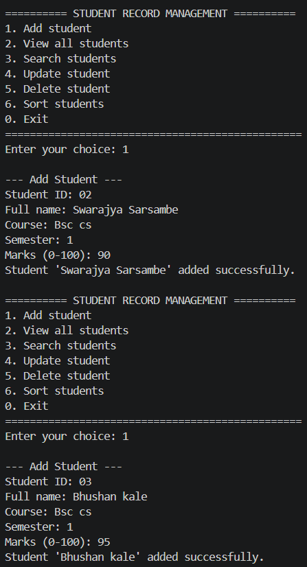
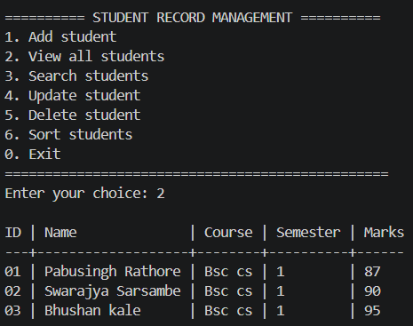
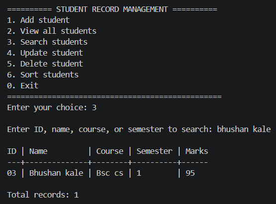

# Student Record Management System

A Python command-line application for keeping a small set of student records. It supports adding, viewing, searching, updating, deleting and sorting records. Data is stored in a CSV file, so it is still available the next time the program is run.

## Features

- Add a student with a unique ID
- View all saved records
- Search by ID, name, course or semester
- Update a student's details and marks
- Delete a record after confirmation
- Sort records by ID, name, course, semester or marks
- Check required fields and marks from 0 to 100
- Save records in CSV format
- Use Python's standard library; no extra packages are needed

## Requirements

- Python 3.10 or newer recommended
- Windows, macOS or Linux

Check that Python is available:

```bash
python --version
```

Some systems use `python3` instead.

## Run the application

Clone the repository and open a terminal in the project directory:

```bash
git clone https://github.com/logicsingh/student-record-management-system.git
cd student-record-management-system
python main.py
```

The application creates `data/students.csv` the first time it needs to save records.

### Try the sample data

To use the included fictional sample records:

```bash
python main.py --data sample_data/students.csv
```

Changes made while using this path are written to the sample CSV. Copy it first if you want to keep the original sample unchanged.

## Run the tests

```bash
python -m unittest discover -s tests -v
```

The test suite checks record creation and persistence, duplicate IDs, field validation, searching, updating, deleting, sorting and CSV handling.

## Project structure

```text
student-record-management-system/
├── main.py
├── student_records.py
├── data/
├── sample_data/
│   └── students.csv
├── screenshots/
└── tests/
    └── test_student_records.py
```

## Screenshots

### Add a student


### View records


### Search records


## A few implementation notes

- The menu and input prompts are kept in `main.py`; record operations and CSV handling are in `student_records.py`.
- Student IDs are checked without regard to letter case, so `S001` and `s001` count as the same ID.
- Marks accept numeric values from 0 through 100.
- The application writes through a temporary file before replacing the data file, which helps avoid leaving a partly written CSV if saving is interrupted.

## Limitations

This is a local, single-user command-line project. CSV storage is easy to inspect and works for a small dataset, but it is not suitable for concurrent users or large-scale record management. There is no login system or web interface.

The sample records are fictional. Do not add real student personal information to a public repository.

## License

MIT. See [LICENSE](LICENSE).
