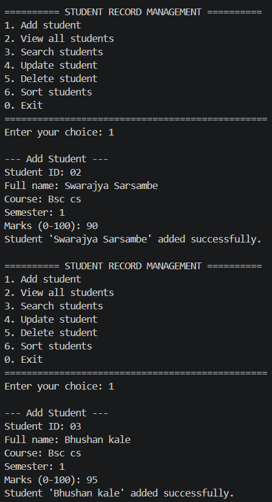
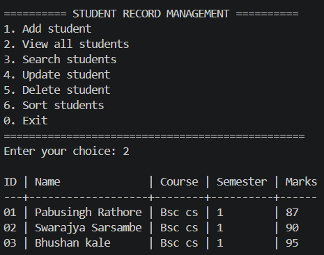
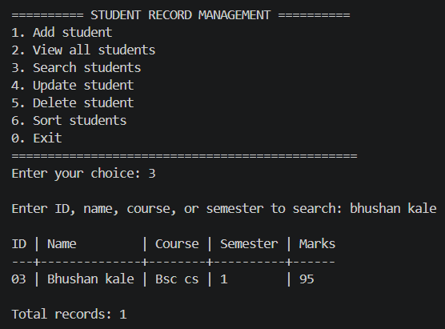

# Student Record Management System

A beginner-friendly Python command-line application for managing student records. It demonstrates core programming, input validation, CSV file handling, searching, sorting, and automated testing.

> This is a portfolio learning project. Sample records are fictional. Record actual development dates honestly; do not backdate commits or present this newly built version as an old college submission.

## Application Preview

### Main Menu and Adding a Student


### View All Student Records


### Search Student Records



## Features

- Add a student with a unique student ID
- View all saved records
- Search by student ID, name, course, or semester
- Update a student's name, course, semester, or marks
- Delete a record after confirmation
- Sort records by ID, name, course, semester, or marks
- Validate required fields and marks from 0 to 100
- Save records in a CSV file so they remain available after restarting
- Use only the Python standard library; no packages to install
- Run automated tests with `unittest`

## Requirements

- Python 3.10 or newer recommended
- Windows, macOS, or Linux
- A terminal or command prompt

Check Python is installed:

```bash
python --version
```

On some systems, use `python3 --version` instead.

## Run the application

1. Download or clone this repository.
2. Open a terminal in the project folder.
3. Run:

```bash
python main.py
```

On systems that use `python3`:

```bash
python3 main.py
```

The program creates `data/students.csv` automatically the first time it runs. Your own records are saved there.

### Try the sample dataset (optional)

This uses the included fictional sample data file instead of your default data file:

```bash
python main.py --data sample_data/students.csv
```

**Note:** This command will modify the sample CSV when you add, update, or delete records. To preserve the original sample, copy it to another location first.

## Menu

```text
1. Add student
2. View all students
3. Search students
4. Update student
5. Delete student
6. Sort students
0. Exit
```

Marks can be whole numbers or decimals from 0 through 100. Student IDs are unique without regard to letter case (`S001` and `s001` are treated as the same ID). Names and course values can contain spaces or commas.

## Run automated tests

From the project root:

```bash
python -m unittest discover -s tests -v
```

Or use `python3` in place of `python`.

The tests cover record creation, persistence, duplicate IDs, validation, search, update, delete, sorting, and CSV handling.

## Project structure

```text
student-record-management-system/
├── main.py                    # Menu and user interaction
├── student_records.py         # Record management and CSV persistence
├── data/
│   └── .gitkeep               # Keeps the empty data directory in Git
├── sample_data/
│   └── students.csv           # Fictional demo data
├── screenshots/
│   └── .gitkeep               # Add your own screenshots here
├── tests/
│   └── test_student_records.py
├── .gitignore
├── LICENSE
└── README.md
```

## Design decisions

- **Separation of concerns:** `main.py` handles user interaction; `student_records.py` handles record rules and storage.
- **CSV:** Human-readable, easy to inspect, and suitable for a small beginner project. It is not intended for concurrent multi-user access.
- **Validation:** Required text fields cannot be blank; marks must be numeric and within range; IDs must be unique.
- **Safer saves:** The application writes to a temporary file and replaces the CSV after a successful write, reducing the chance of a partially written data file.
- **No dependencies:** Built-in modules (`csv`, `pathlib`, `argparse`, `tempfile`, `unittest`, and others) keep setup simple.

## Limitations and future improvements

- CSV is suitable for learning, not large or concurrent databases.
- The program is a local command-line app and does not have login accounts or a web interface.
- Future improvements could include SQLite storage, export reports, a GUI, and more detailed input validation.

## Learning outcomes

After completing and understanding this project, you should be able to explain:

- Functions, loops, dictionaries, lists, and exception handling
- Reading and writing CSV files
- Searching and sorting records
- Separating application logic from the interface
- Writing unit tests and running them from the terminal
- Using Git and GitHub to document a small software project

## Suggested Git workflow

Make commits as you actually implement and test features. For example:

```bash
git init
git add .
git commit -m "Create student record management system"
```

Then create an empty repository on GitHub and follow GitHub's instructions to connect and push it. Do not commit private student information or credentials.
